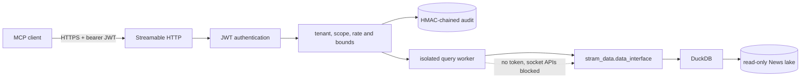

# Stram Qualitative MCP: plan

Status on 2026-11-01: M0 to M3 and M5 are done. A loopback demonstration runs on the data host.

This service gives agents read-only access to Stram's News & Intelligence data over MCP. It follows
[`stram_quant_mcp`](https://github.com/SiddarthaKoppaka/stram_quant_mcp) and keeps its security model.
It differs only where text behaves differently from numbers.

## 1. Vision and MVP

**Full vision.** An agent can research a company or theme across news, filings and social sources.
It can search by meaning, read sources with citations, follow how a story spread, track sentiment over
time, and line all of that up with Stram's quantitative data. Point-in-time reads make the same
research usable for backtests.

**MVP.** An agent can find what was reported about the 80 tracked companies, read the text we hold,
look up SEC filings, and see attention and tone over time. The MVP's first users are the two
stream owners and an agent working with them.

| Capability | MVP | After MVP |
|---|---|---|
| Company and keyword search | Yes | Ranking, phrases and entities |
| Read article and filing text | Yes | |
| SEC filings by form | Yes | |
| Daily volume and GDELT tone | Yes | |
| One result per story | Yes (exact title matches) | Reworded copies, using embeddings |
| Semantic search | | Phase 2: embeddings, TurboVec |
| Company-level sentiment | | Phase 2: FinBERT or JEV |
| Backtesting | Ingestion-time `as_of` only | Labelled publication-time mode |
| Social and investor-relations sources | | When collected |

Nothing in the MVP should block these later additions. Each one is a new tool or an additive field.

## 2. Architecture

The service is a thin Tool Plane. It owns transport, identity, authorization, bounds, worker isolation,
audit and telemetry. It owns no SQL, ingestion, ranking or scoring. All data comes through the public
`stram_data.data_interface`, as ADR 002 requires.

**The worker has no network, so it cannot reach PostgreSQL.** Anything the MCP needs must therefore be
in Parquet or the text files, through the Data Interface. PostgreSQL would be a faster route to story
groups, but it would break both the isolation and ADR 002.

### Copied from `stram_quant_mcp`

We copy the code at commit `d191333` and rename it. A shared library can wait until both services are
deployed, because Quant's staging work is still changing `audit.py` and its deployment.

| Reused unchanged apart from naming | Rewritten |
|---|---|
| `auth`, `audit`, `policy`, `errors`, `telemetry`, `server`, `worker`, `entrypoint`, `settings`, `tools/`, `ENGINEERING.md`, security tests, CI gates | `tool_registry`, `tool_adapter`, `tool_models`, fixtures, `docs/TOOLS.md`, `contracts/` |

Naming: package `stram_qualitative_mcp`, tools `qual_*`, scopes `qual:*`, settings `STRAM_QUAL_MCP_*`.

### What differs from Quant

| Area | Quant | Qualitative | Why |
|---|---|---|---|
| Result rows | 100 default, 500 max | 20 default, 100 max | News rows use far more of a model's context |
| Worker memory | 1 GB | 3 GB | Live trials failed at 1 GB and on some queries at 2 GB |
| Lake mount | `data-lake/parquet` | `data-lake/news/parquet` and `bodies` | Text lives beside Parquet; the raw archive is not exposed |
| Content trust | Numbers | Untrusted third-party text | See section 4 |
| Permissions | Discover, read, lineage, analytics | Discover, read, text, analytics | Full text gets its own scope |

## 3. Tools

All tools are read-only, idempotent and closed-world, with closed input and output schemas. Each has
one clear job. There is no generic query, URL-fetch or file tool. The envelope matches Quant's, with
`warnings` always present.

| Tool | Purpose | Scope | Deadline |
|---|---|---|---|
| `qual_describe_coverage` | Sources, date ranges, counts, freshness, tracked tickers, known gaps | `qual:discover` | 10 s |
| `qual_search_news` | Result cards by ticker, text, provider and date | `qual:read` | 10 s |
| `qual_get_filings` | SEC filings by ticker, form and date | `qual:read` | 10 s |
| `qual_get_article` | One article with bounded text and its versions | `qual:text` | 10 s |
| `qual_get_news_timeline` | Daily article and story counts, with average GDELT tone | `qual:analytics` | 15 s |

### `qual_search_news`

- Requires `start_date`, `end_date`, and at least one of `tickers`, `text` or `providers`.
- Filters: up to 10 `tickers`, `min_confidence` (default 0.6), `providers`, `text` (2 to 100 characters),
  `include_flagged` (default false), `collapse_stories` (default true), `as_of`.
- Date range: up to 1,830 days with `tickers`, up to 92 days without. Wider requests are rejected, never
  clamped. A full year without a ticker took 12 to 16 seconds and 4.7 GB on the live lake.
- Returns cards: `article_id`, `story_id`, `copies`, `provider`, `publisher`, `published_at`,
  `first_ingested_at`, `title`, `summary`, `url`, `tickers` with method and confidence, `text_available`,
  `version_count`, `quality_flags`. There is no cursor; `truncated=true` means narrow the request.

### `qual_get_filings`

- Requires `start_date`, `end_date` and 1 to 10 `tickers`. Optional `forms`, such as `8-K`, up to 10.
- Returns accession number, CIK, form, items, filed time, title, summary and URL.
- Filing metadata is stored in `metadata_json`, so the form and items are available from Parquet.

### `qual_get_article`

- Requires `article_id`. Optional `offset` (default 0) and `max_chars` (default 4,000, max 8,000), which
  covers the typical article: the sample median was 4,288 characters and the 90th percentile 8,551.
- Returns the card, `text_available`, the `untrusted_text` slice, `total_chars`, and `has_more`.
- When we hold no text it returns the metadata and `text_available=false`. This is a normal result.

### `qual_get_news_timeline`

- Requires 1 to 5 `tickers`, `start_date` and `end_date`, with a span up to 366 days.
- Returns per ticker and UTC day: articles and mean tone, with the number of articles behind that
  mean. M4 adds stories. Days without articles are absent rather than zero.
- Tone is GDELT's score for a whole article. It is labelled `gdelt_article_tone`, and is not sentiment
  about the company.

### `qual_describe_coverage`

- Takes no input.
- Returns, per provider: date range, record count and latest ingestion, plus tracked tickers, the text
  coverage figures, and fixed limitations.
- Lists missing 15-minute GDELT files in the last 30 days, so a gap is not mistaken for a quiet period.

## 4. Handling text

**All third-party strings are untrusted.** An article can contain instructions aimed at the model
reading it, and filtering cannot reliably catch that. So:

- Titles, summaries, publishers, URLs and article text are returned only as data fields, never in tool
  descriptions, errors or warnings.
- `text` sits in a field named for what it is, `untrusted_text`, and the envelope carries
  `content_trust: "untrusted_external"`.
- Control and zero-width characters are removed from `untrusted_text`. This reduces hidden text and does
  not make the text safe.
- Client guidance in `docs/TOOLS.md` tells consumers to treat it as data. The MCP cannot enforce that.
- `qual:text` is a separate scope, so a client can search without ever receiving article bodies.
- The service never fetches `url`. The body fetcher honours `robots.txt` and paywalls; a consumer would
  not.

**Text belongs to its publishers.** The MVP is internal. Check licensing before anyone else gets
`qual:text`. SEC filings are public records; news articles are not.

**This repository is public.** Test fixtures must be synthetic. Real article text, hosts, addresses and
credentials must never be committed.

## 5. Being honest about the data

These facts come from the live data on 2026-11-01. Tool output must not suggest otherwise.

| Fact | Rule |
|---|---|
| GDELT is 97% of records, with titles and no summaries | Show its title and source; do not imply it was read |
| Full text exists for about 66,000 articles, and Finnhub is still growing | `text_available` on every card |
| Parquet says `pending` for 5.19M items that will not be fetched | Report `text_available=false`; do not expose `pending` |
| 2.57M of 5.81M ticker links are below 0.6 confidence | Default `min_confidence` to 0.6 and show the match method |
| Confidence is a rule-based label | Never present it as a probability |
| Some spam passes the `content_farm` flag | State this in coverage; a filter is pipeline work |
| Exact-title grouping misses reworded copies | Call it `copies`; do not claim it counts independent reports |
| `as_of` uses ingestion, and history arrived from about Oct 30, 2026 | Warn when `as_of` precedes that date |
| `published_at` is the provider's time | Label it as such |
| 55 GDELT files are missing since Oct 31 | Report gaps in coverage |

## 6. Required `stram_data` work

M2's and M3's additions shipped in `stram_data` 1.5.0 and 1.6.0. Every item left adds to the Data Interface and needs a new contract baseline. These go in `stram_data`
pull requests, and the Data Interface needs Sid's review.

| Item | Change | Needed by |
|---|---|---|
| Stories | `story_id` and copy counts from Parquet | M4 |

**SEC text.** All 3,936 SEC announcements say `fetched`, but none has a `body_path`. They hold a
500-character summary, and the full document is only in the raw archive, which this plan does not
expose. M2 returns the summary with `text_available=false`. Writing that text to `bodies/` is a later
pipeline job.

**Stories.** `article_stories` is only in PostgreSQL. M4 reproduces the `news_data.story_id` rule in
`NewsLake` and tests it against PostgreSQL on a sample, so nothing has to be rewritten in the lake.

## 7. Deployment

Quant MCP is not deployed. It is waiting for Keycloak, private TLS and a reviewed image digest.

**MVP (M5).** Runs on the data host on a loopback port, on the real lake. It uses the
integration-test identity setup and is reached through an SSH tunnel. This is a working demonstration,
not staging.

**Staging (M6).** Follows Quant's setup once its Keycloak work lands: same issuer, its own audience, its
own `qual:*` client scopes.

Both need an administrator on the data host, because the lake is readable only by its owner:

- A non-login service user, separate from Quant's.
- A read-only bind mount of the News `parquet` and `bodies` directories.
- An audit volume and key, separate from Quant's.
- Rootless Podman, as Quant uses.

`stram_data` is private and this repository is public, so hosted CI cannot install the dependency
without a credential. Follow Quant's approach: the pinned commit locally and a vendored wheel for the
image. Do not enable a self-hosted runner on a public repository.

## 8. Milestones

Implement one reviewed milestone at a time and record evidence here.

| # | Deliver | Done when |
|---|---|---|
| M0 | Copy and rename, with Quant's tools removed | Security tests and all gates pass with zero tools or one stub |
| M1 | `qual_search_news`, with synthetic fixtures | Passes end to end through the official MCP client on 1.4.1 |
| M2 | Text and filings (`stram_data` 1.5) | `qual_get_article` and `qual_get_filings` pass; injection and text-bound tests pass |
| M3 | Coverage and timeline | All five tools pass; schemas and hashes checked in |
| M4 | Story collapsing | Story IDs match PostgreSQL on a sample |
| M5 | Real lake on the data host, loopback only | Budgets in section 9 met on the live lake; pipelines unaffected |
| M6 | Staging with Keycloak | Quant's M6 acceptance checks pass for this service |

M4 remains, and M5 ran ahead of it.

**M5 evidence (2026-11-01).** The service runs on the data host on a loopback port, with a read-only view of
`parquet` and `bodies`. Through the official MCP client over HTTP on the live lake: coverage 2.7 s, ticker
1 month 1.9 s, ticker 1 year 4.1 s, 3 tickers 1 year 100 rows 5.1 s, text 1 month 2.9 s, filings 0.4 s, article
2.3 s, timeline 1.1 s. All are within section 9's budgets, and some are close. Requests without a valid
token get 401 and a wrong host gets 421. Pipelines stayed active. The demonstration signing key and
one-hour tokens are not staging.

**M3 evidence (2026-11-01).** On `stram_data` 1.6.0 (`947e49b`), all five tools pass through the official
MCP client on synthetic data. Through the isolated worker on the live lake, read-only: coverage 1.2 s,
AAPL October timeline 0.9 s, 5 tickers over a year 2.5 s. The AAPL October total matches search at
1,412 articles. Only 33 of them carry tone at confidence 0.6, because most GDELT links for AAPL sit
just under it, so `tone_articles` is returned with every mean.

**M2 evidence (2026-11-01).** On `stram_data` 1.5.0 (`ff8b151`), `qual_get_article` and
`qual_get_filings` pass through the official MCP client on synthetic data. Through the isolated worker
on the live lake, read-only: filings 0.2 s, article about 1.6 s. Paged text, missing text and SEC
summaries all behave as specified. Only `fetched` counts as text we hold.

**M0 evidence (2026-11-01).** Copied from `stram_quant_mcp` at `d191333`, pinned to `stram_data` 1.4.1
(`4e9fe24`). Tests ran on Linux, on the data host, from a throwaway copy using Python 3.13.

**M1 evidence (2026-11-01).** `qual_search_news` passes through the official MCP client against a
synthetic news lake. `collapse_stories` and `story_id` wait for M4, and `copies` with them.
Through the isolated worker at 3 GB on the live lake, read-only: ticker 1 month 1.1 s, ticker 1 year
2.6 s, 3 tickers 1 year 100 rows 3.9 s, text 1 month 2.4 s. All are within section 9's budgets.

## 9. Budgets

Measured on the live lake after compaction, on an 8-core host. M5 repeats these through the service.

| Query | Measured | Budget |
|---|---|---|
| Ticker, 1 month, 20 rows | 0.8 s | 2 s |
| Ticker, 1 year, 20 rows | 2.5 s | 5 s |
| 3 tickers, 1 year, 100 rows | 4.3 s | 8 s |
| Text, 1 month, 20 rows | 2.5 s | 5 s |

One query runs at a time, as in Quant. The worker's memory limit is 3 GB.

## 10. Risks

| Risk | Response |
|---|---|
| The file count grows and reads slow down again | Compaction is manual today; schedule it before M5 |
| Worker limits are hit on heavier filters | Requests are bounded by section 3; out-of-memory returns a safe error |
| Prompt injection through news text | Section 4 reduces it, but consumers must treat text as data |
| `get_news` is shared with the Quant-owned contract | Additive only, with Sid reviewing each change |
| Upstream security fixes land only in Quant | Compare `src/` against Quant at each milestone, until a shared library exists |
| Search is substring only | Good enough for the MVP; semantic search is the planned answer |
| Disk space on the data host | The MCP adds an audit file only; watch it during the Finnhub fetch |
