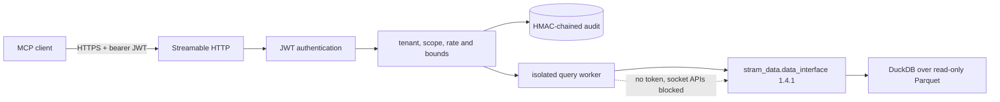

# Stram Qualitative MCP

Stram Qualitative MCP is the read-only MCP Tool Plane for Stram's News & Intelligence data. It exposes
the pinned `stram_data.data_interface` 1.4.1 API over authenticated Streamable HTTP. This repository
owns transport, identity, authorization, bounds, worker isolation, audit and telemetry. It does not
own SQL, ingestion, ranking, scoring, lake schemas or AI orchestration.

It is built from [`stram_quant_mcp`](https://github.com/SiddarthaKoppaka/stram_quant_mcp) at commit
`d191333` and keeps that service's security model.

Status: M0 only. The security and transport layers are in place with one placeholder tool,
`qual_describe_coverage`. No news tool exists yet and nothing is deployed. See [PLANS.md](PLANS.md).

## Architecture in five minutes



Every call is authenticated and authorized before worker dispatch. The worker receives only a tool
name, validated arguments and a request ID. It imports only the public Data Interface. Terminal
success, denial and failure outcomes are appended to the audit chain; an audit append failure fails
the call closed. See [Architecture](docs/ARCHITECTURE.md) for the complete lifecycle and boundaries.

## Quick start

Supported toolchain: CPython 3.12 through 3.14 and `uv`. The lock pins the exact `stram-data` source
commit for release 1.4.1. Private repository access is needed only when the dependency is not already
available in the local cache.

```bash
uv sync --frozen --dev
uv run python -c 'import stram_data; assert stram_data.__version__ == "1.4.1"'
uv run pytest tests/integration/test_mcp_client.py -q
```

The integration test starts the real server on loopback, signs a short-lived JWT, connects with the
official MCP SDK client, discovers the placeholder tool and calls the real Data Interface against
`tests/fixtures/lake`. It does not use production credentials or mocked qualitative responses.

Run the complete local gate:

```bash
uv run pytest --cov --cov-report=term-missing
uv run mypy
uv run ruff check .
uv run ruff format --check .
uv run python -m stram_qualitative_mcp.tools.export_schema --check
uv run python tools/check_docs.py
```

Container startup is stricter than local tests: the `serve` entrypoint runs preflight and refuses root
execution, a writable root filesystem, a writable lake, or dependency/interface drift.

## Documentation

Use the entry point that matches the job:

| Need | Document |
|---|---|
| Understand boundaries and failure behavior | [Architecture](docs/ARCHITECTURE.md) |
| Install, test and connect a client | [Onboarding](docs/ONBOARDING.md) |
| Look up tool schemas, scopes and errors | [Tool reference](docs/TOOLS.md) |
| Build, stage, monitor, recover or roll back | [Operations](docs/OPERATIONS.md) |
| Review Data host prerequisites and templates | [Deployment](deploy/README.md) |
| See milestone evidence and unresolved decisions | [Plans](PLANS.md) |
| Apply normative engineering rules | [Engineering standards](ENGINEERING.md) |
| Review the PyArrow exception | [Security exceptions](docs/SECURITY_EXCEPTIONS.md) |
| Read release-candidate notes | [Changelog](CHANGELOG.md) |

Do not deploy, access production secrets or change the data host without separate authorization.
