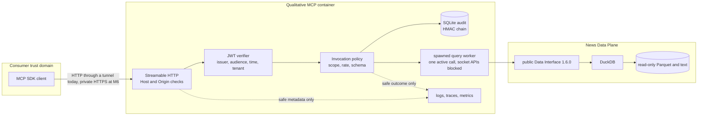
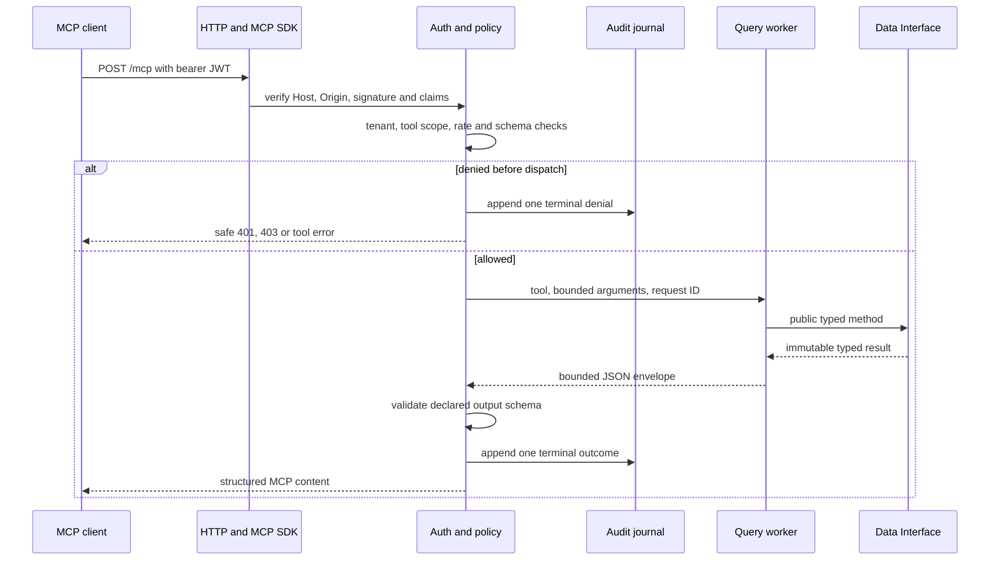
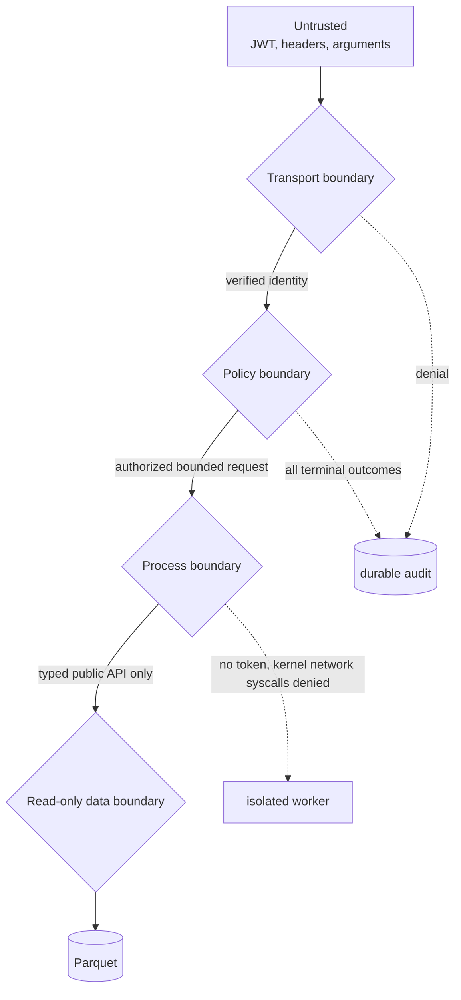
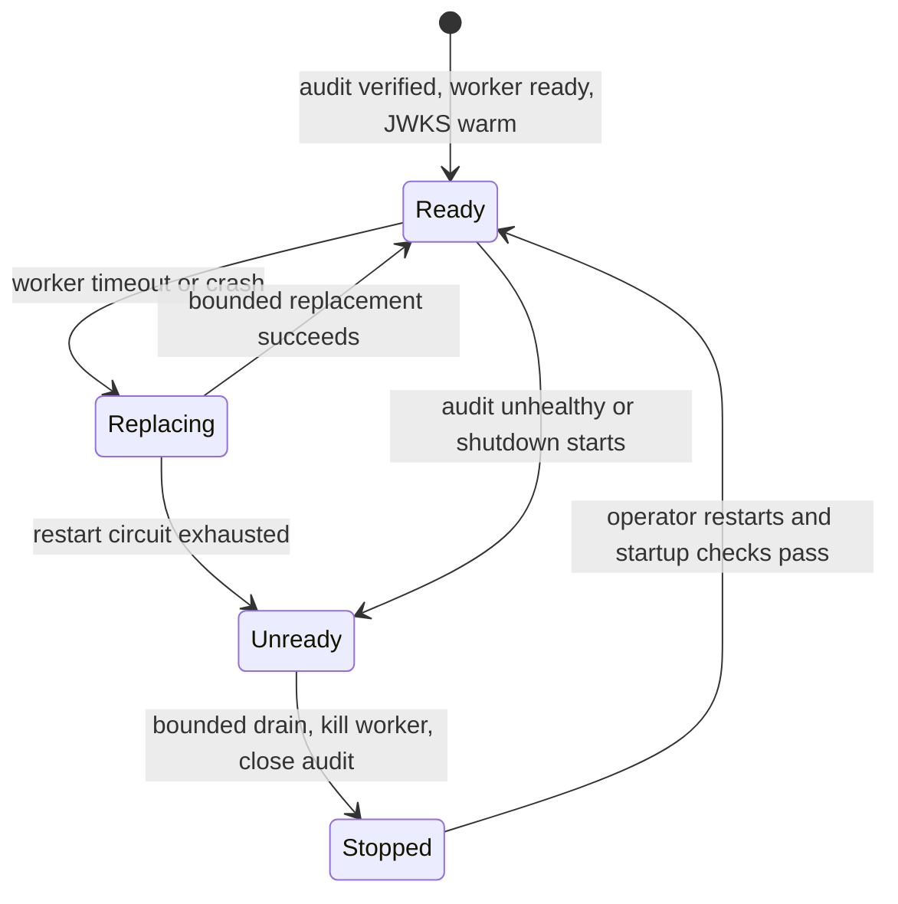

# Architecture

This service is a thin, independently deployable MCP Tool Plane. It turns authenticated MCP requests
into calls to the public `stram_data.data_interface` 1.6.0 API. News logic stays in the Data Plane;
this repository adds no SQL, joins, ranking, scoring or write paths.

## Service topology

The HTTP process owns identity and audit. The worker never receives a bearer token, authorization
header or caller claims. On Linux, it installs a fail-closed seccomp filter before importing the Data
Interface: the full socket syscall family and `io_uring` are denied, and Python socket entry points are
also replaced. The container and host network policy separately control the HTTP process. The Data
Interface alone owns DuckDB and lake access.

## Request lifecycle

`src/stram_qualitative_mcp/tool_registry.py` is the reviewed tool catalog. Pydantic input and output models
are closed and immutable. `QualToolAdapter` performs only model translation and direct public-method
dispatch. Worker JSON IPC is capped, each tool has a deadline, only one query executes at a time and
the queue is bounded.

Authorization is repeated at dispatch even though authentication happens in HTTP middleware. A call
must carry the configured issuer, tenant and tool-specific scope. Invalid tool names and invalid
arguments never reach the Data Interface. The official MCP annotations are descriptive; server-side
policy is authoritative.

## Security boundaries

- Transport accepts only configured Host and Origin values and asymmetric JWT algorithms. URLs
  require HTTPS unless they are loopback and insecure HTTP is explicitly enabled, as in the
  demonstration. Signature, issuer, audience, expiry, issued-at, optional not-before, subject,
  client, scope and tenant are validated. JWKS is warmed before readiness.
- Policy requires one exact scope per tool and derives tenant only from verified claims. The rate
  limiter and worker admission structures are bounded.
- Audit is a separate SQLite WAL journal using synchronous `FULL`, canonical JSON, monotonic sequence
  numbers and an HMAC link to the previous record. The key is file-mounted separately. The journal is
  tamper-evident, not protection against a host-root attacker; host-owned external checkpoints close
  that gap operationally.
- The runtime image uses UID/GID 10001, a read-only root, dropped capabilities, no-new-privileges,
  bounded tmpfs and read-only binds of `parquet` and `bodies`. Container `serve` runs preflight before opening the server.
- The Linux worker's architecture-checked seccomp policy denies the socket syscall family and
  `io_uring` on reviewed `x86_64` and `aarch64`; unsupported Linux architectures fail worker startup.
  A host egress policy for the separate HTTP process is an M6 item.
- Logs, traces and metrics use fixed allowlists. They exclude tokens, claims, raw arguments, raw
  results, paths, subjects and unbounded identifiers.

## Failure handling

A timeout or broken worker connection kills the worker before a replacement starts. Replacements have
a configurable cap and delay; repeated infrastructure failures open the circuit and make readiness
false until the service is restarted. A successful worker response clears the consecutive-failure
counter. Cancellation waits for bounded worker cleanup and then writes a terminal `cancelled` audit
outcome. Forced shutdown cannot respawn a worker.

Audit append failure converts the client result to `unavailable`, marks audit unhealthy and makes
readiness false. The service never retries a data query or audit append automatically. Telemetry
export failure is best-effort and does not block a safe read.

## Data semantics

Cards report what the Data Interface returns, with three deliberate changes. `body_path` and
`body_status` never leave the service. They become `text_available`, which is true only when text was
fetched in full. Article text is named `untrusted_text`, with control and format characters removed.
Every envelope carries `content_trust: "untrusted_external"`.

Search defaults to confidence 0.6 and hides flagged items. Limits are rejected, never clamped. An
article is its latest version, with ticker links added up across versions.

The worker reports the exact `stram-data` version, interface version and availability-policy hash at
startup, and a mismatch fails startup. Schemas and their SHA-256 hashes are checked into
`contracts/tool_schemas.json`.

The Data Interface needs two News paths: the Parquet root and `bodies/` beside it. The worker passes
the mounted Parquet root to both `parquet_root` and `news_parquet_root`, because the MCP does not read
Quant data. The worker cannot reach PostgreSQL, so anything a tool needs must be in Parquet or the
text files.

## Ownership map

| Component | Owns | Must not own |
|---|---|---|
| MCP client/application | User intent and orchestration | Data calculations or direct lake access |
| This repository | MCP transport, identity, policy, audit, isolation, safe serialization | SQL, data ingestion, ranking, lake repair |
| `stram_data.data_interface` | News queries, text reads, coverage, timelines, bounds | MCP, authentication or orchestration |
| Data host operators | Identity, mounts, secrets, networking, image, backup and rollback | Ad hoc Data Plane mutation |

See [Tool reference](TOOLS.md) for contracts, [Operations](OPERATIONS.md) for controls and
ADR 002 in `stram_data` for the upstream
boundary decision.
