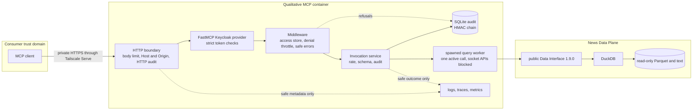
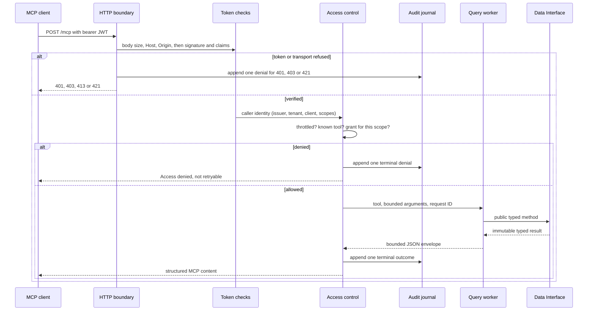
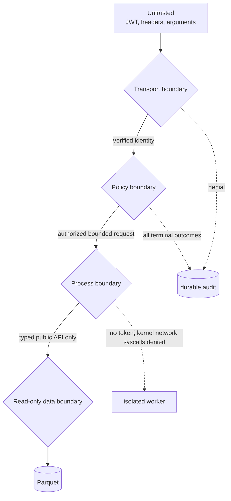
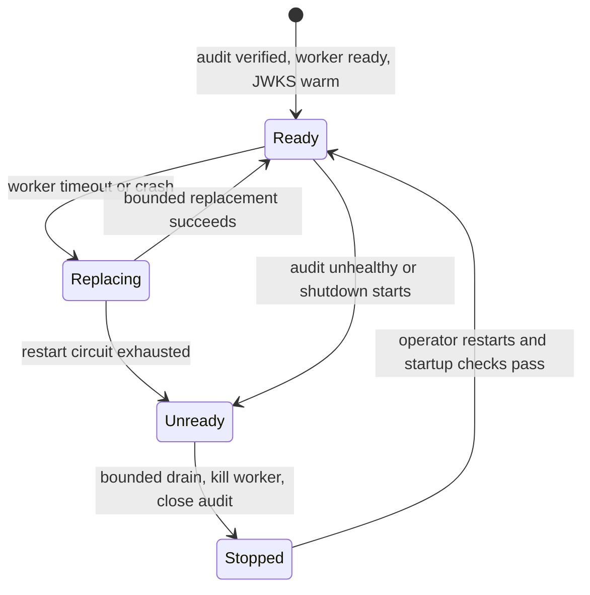

# About the architecture

This service is a thin, independently deployable MCP Tool Plane. It turns authenticated MCP requests
into calls to the public `stram_data.data_interface` 1.9.0 API. News logic stays in the Data Plane;
this repository adds no SQL, joins, ranking, scoring or write paths. It runs on
[FastMCP](https://gofastmcp.com/), like the Quant MCP; see
[About the FastMCP migration](about-the-fastmcp-migration.md) for why.

## Service topology

The HTTP process owns identity and audit. The worker never receives a bearer token, authorization
header or caller claims. On Linux, it installs a fail-closed seccomp filter before importing the Data
Interface: the full socket syscall family and `io_uring` are denied, and Python socket entry points are
also replaced. The Data Interface alone owns DuckDB and lake access.

## Request lifecycle

`tool_registry.py` is the reviewed tool catalogue, and `fastmcp_tools.py` turns each `ToolSpec` into a
FastMCP tool that publishes exactly the reviewed schemas, so the contracts and their hashes cannot
drift. Nothing is written per tool. Pydantic input and output models are closed and immutable.
`QualToolAdapter` only translates models and dispatches to public methods. Worker JSON IPC is capped,
each tool has a deadline, only one query runs at a time and the queue is bounded.

## Who decides access

One default-deny store, `ScopeGrantStore`, decides both what a caller sees in `tools/list` and what
it may call, so the two cannot disagree. A caller is granted a tool only if its verified token has the
configured issuer and tenant and the tool's one scope. The invocation service checks again at
dispatch. A caller denied five times in a minute is throttled, and sees no tools until the window
passes. The official MCP annotations are descriptive; server-side policy is authoritative.

## Security boundaries

- **Transport** accepts only configured Host and Origin values, bodies up to 1 MiB, and one asymmetric
  JWT algorithm. URLs require HTTPS unless they are loopback and insecure HTTP is explicitly enabled, as
  in demo mode. FastMCP checks signature, issuer, audience and expiry; this service's
  `StrictVerifier` also requires issued-at, subject, client, scopes and the tenant, and keeps only the
  issuer and tenant. Readiness waits until the JWKS endpoint has served a key.
- **Policy** derives the tenant only from verified claims. The rate limiter, denial throttle and worker
  queue are bounded.
- **Audit** is a separate SQLite WAL journal using synchronous `FULL`, canonical JSON, monotonic
  sequence numbers and an HMAC link to the previous record. Every call, including refusals, ends in
  exactly one record, with one exception: HTTP denials before dispatch (bad token, Host or Origin),
  which a caller without credentials can cause at will. The first 20 in each 60 seconds are recorded
  one by one; the rest are counted and written as one `transport_denials_sampled` record, whose
  `row_count` is the number skipped, when the next window's first denial arrives. The key is mounted separately. The journal is tamper-evident, not protection
  against a host-root attacker; external checkpoints close that gap operationally.
- **Runtime:** UID/GID 10001, a read-only root, dropped capabilities, no-new-privileges, bounded tmpfs
  and read-only binds of `parquet` and `bodies`. Container `serve` runs preflight before opening the
  server.
- **Worker:** an architecture-checked seccomp policy denies the socket syscall family and `io_uring`
  on reviewed `x86_64` and `aarch64`; unsupported architectures fail worker startup. Host egress
  limits for the HTTP process are still open.
- **Telemetry:** logs, traces and metrics use fixed allowlists. They exclude tokens, claims, raw
  arguments, raw results, paths, subjects and unbounded identifiers. FastMCP's own logging is silenced
  because it can include exception text.

## Failure handling

A timeout or broken worker connection kills the worker before a replacement starts. Replacements have
a configurable cap and delay; repeated failures open the circuit and make readiness false until the
service is restarted. A successful response clears the failure count. Cancellation waits for bounded
worker cleanup and then writes a terminal `cancelled` audit outcome.

Every failure reaches the caller as one fixed message with a code and a `retryable` flag; no exception
text, path or stack trace can. Audit append failure converts the result to `unavailable`, marks audit
unhealthy and makes readiness false. The service never retries a data query or audit append
automatically. Telemetry export failure is best-effort and does not block a safe read.

## Data semantics

Cards report what the Data Interface returns, with three deliberate changes. `body_path` and
`body_status` never leave the service. They become `text_available`, which is true only when text was
fetched in full. Article text is named `untrusted_text`, with control and format characters removed.
Every envelope carries `content_trust: "untrusted_external"`; see [About the data](about-the-data.md).

Search defaults to confidence 0.6 and hides flagged items. Limits are rejected, never clamped. An
article is its latest version, with ticker links added up across versions.

The worker reports the exact `stram-data` version, interface version and availability-policy hash at
startup, and a mismatch fails startup. Schemas and their SHA-256 hashes are checked into
`contracts/tool_schemas.json`. The worker passes the mounted Parquet root to both `parquet_root` and
`news_parquet_root`, because the MCP does not read Quant data. It cannot reach PostgreSQL, so anything
a tool needs must be in Parquet or the text files.

## Operating rules

- The service only reads. The mounts are never writable, and it never runs as the account that owns
  the lake.
- `stram-qual` never gets access to the raw archive.
- Demo mode, with plain HTTP and a test login, is never published beyond loopback. Staging is
  published only on the tailnet, through Tailscale Serve.
- Secrets are never passed as command-line arguments or put in the settings file.

## Ownership map

| Component | Owns | Must not own |
|---|---|---|
| MCP client/application | User intent and orchestration | Data calculations or direct lake access |
| This repository | MCP transport, identity, policy, audit, isolation, safe serialization | SQL, data ingestion, ranking, lake repair |
| `stram_data.data_interface` | News queries, text reads, coverage, timelines, bounds | MCP, authentication or orchestration |
| Keycloak realm, owned with the Quant MCP | Clients, scopes, audience and tenant claims | Tool behavior |
| Data host operators | Identity, mounts, secrets, networking, image, backup and rollback | Ad hoc Data Plane mutation |

See the [tool reference](../reference/tools.md) for contracts, [Operate the service](../how-to/operate-the-service.md)
for procedures, and ADR 002 in `stram_data` for the upstream boundary decision.
