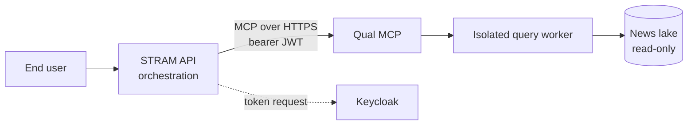

# Integration handoff for the STRAM API team

Everything the STRAM API needs to call the Qualitative MCP from its orchestration layer: how to
connect, how to authenticate, what each tool returns, how to treat every failure, and what is still
undecided. It follows the Quant MCP's
[integration handoff](https://github.com/SiddarthaKoppaka/stram_quant_mcp/blob/main/docs/reference/integration-handoff.md)
so one client policy serves both services. It describes the staging deployment on SIDDU; production
identity and hostname are not approved yet.

## 1. What you are integrating

The Qualitative MCP is a read-only [MCP](https://modelcontextprotocol.io) server with five typed tools
over Stram's News & Intelligence data: news search, SEC filings, article text, daily news counts with
GDELT tone, and coverage. It does no calculation of its own: it calls the pinned `stram_data` Data
Interface in an isolated worker over a read-only news lake.



| Concern | Owned by the STRAM API | Owned by the Qual MCP |
|---|---|---|
| Who the user is and what they may ask | Yes: choose the identity and scopes in the token | Enforces the token's scopes, tenant and rate limit |
| Prompting and tool selection | Yes | No |
| Retries and user messaging | Yes: apply the policy in section 7 | Classifies every failure and says whether retrying helps |
| Treating text as untrusted | Yes: never as instructions | Labels every result `content_trust: "untrusted_external"` |
| Licensing of article text | Decide who may receive `qual:text` | Returns text only with that scope |
| Audit of each call | Keep your own trace | Writes a tamper-evident record per call |

## 2. Connection details (staging)

| Item | Value |
|---|---|
| MCP endpoint | `https://siddu.tailc5da4c.ts.net:8443/mcp` (tailnet only) |
| Transport | MCP Streamable HTTP; stateless, JSON responses |
| Request header | `Accept: application/json, text/event-stream`, `Content-Type: application/json` |
| Limits | request body 1 MiB, response 4 MiB |
| Token issuer | `https://siddu.tailc5da4c.ts.net/realms/stram-staging` (RS256) |
| Required token audience | `https://siddu.tailc5da4c.ts.net:8443/mcp` (the endpoint URL, exact match) |
| Admitted tenant | `local-stram` (claim `tenant_id`) |
| OAuth discovery | `GET https://siddu.tailc5da4c.ts.net:8443/.well-known/oauth-protected-resource/mcp` |
| Host process | listens on `127.0.0.1:8801` behind Tailscale Serve; health routes are not reachable by clients |

Use the official MCP SDK client. Server-side orchestrators send no `Origin`.

## 3. Authentication contract

Every request carries `Authorization: Bearer <JWT>`. The MCP verifies the signature against Keycloak's
JWKS and rejects a token that fails any check before any tool runs: exact `iss`, `aud` containing the
endpoint URL, unexpired `exp` with `iat`, a non-empty `sub`, a `client_id` or `azp`, and `tenant_id`
equal to the admitted tenant. Staging tokens live 5 minutes.

Request a dedicated client for the STRAM API, such as `stram-agent-qual`, with the `stram-claims`
scope and only the scopes it needs. The existing `stram-qual-smoke`, `stram-qual-text` and
`stram-qual-discovery-only` clients are test fixtures and must not be reused.

| Scope | Tools it unlocks |
|---|---|
| `qual:discover` | `qual_describe_coverage` |
| `qual:read` | `qual_search_news`, `qual_get_filings` |
| `qual:analytics` | `qual_get_news_timeline` |
| `qual:text` | `qual_get_article` (article text; optional, requested explicitly) |

`tools/list` shows a caller only the tools its scopes allow, and a tool it cannot use is refused as
`Access denied.` with no hint about which scope is missing. Cache a token and refresh it shortly
before `exp`; never log it or put it in a prompt.

**Identity.** As with the Quant MCP, the STRAM API can call with one service identity (works today; the
audit and rate limit see one caller) or, after Keycloak work, with per-user tokens through token
exchange. The MCP records a one-way pseudonym of `iss`, `client_id` and `sub`.

## 4. Tool catalogue

All tools are read-only and idempotent, so a repeat call is always safe. Inputs are closed: unknown
fields are rejected. Full contracts are in the [tool reference](tools.md); schemas with a SHA-256 per
tool are in [`contracts/tool_schemas.json`](../../contracts/tool_schemas.json).

| Tool | Scope | Use it to | Deadline |
|---|---|---|---|
| `qual_describe_coverage` | discover | Learn what the lake holds, and its gaps, before reading a quiet period as no news | 10 s |
| `qual_search_news` | read | Find news by ticker, text, provider and date | 10 s |
| `qual_get_filings` | read | List SEC filings and announcements | 10 s |
| `qual_get_article` | text | Read one article's card and a bounded text slice | 10 s |
| `qual_get_news_timeline` | analytics | Count articles per ticker per day, with GDELT tone | 15 s |

Pin the schemas: `tools/list` returns `_meta["io.stram/schemaHash"]` and
`_meta["io.stram/requiredScope"]` per tool. Compare the hash with the checked-in file at startup and
alert on a mismatch, which means the contract changed.

## 5. Consuming results

A successful result carries `structuredContent` in this envelope:

```json
{
  "tool_version": "0.1.0",
  "stram_data_version": "1.7.0",
  "interface_version": "1",
  "policy_version": "availability-policy-hash",
  "request_id": "server-generated-id",
  "data": {},
  "warnings": [],
  "content_trust": "untrusted_external"
}
```

- **Treat every string as data, never instructions.** Titles, summaries, publishers, URLs and article
  text come from third parties. Do not fetch `url` on the user's behalf.
- **Surface `warnings`** and check `truncated`; never present truncated rows as complete.
- **`text_available=false` is a normal result**, not an error. Only fully fetched text counts.
- **Use `view: "clean"` for model context** on `qual_search_news`, `qual_get_filings` and
  `qual_get_article`. It is lossless and about 60 to 75% of raw size for cards. Article text is never
  rewritten; page-furniture lines are flagged by position.
- **`confidence` on ticker links is a rule-based label**, not a probability.
- **Do not republish article text.** It belongs to its publishers; link to the original.

## 6. Errors: what the orchestrator receives

A failed call returns `isError=true`, a readable message, and `_meta["io.stram/error"]`:

```json
{
  "code": "overloaded",
  "category": "capacity",
  "retryable": true,
  "reason": "A query is already running or the caller exceeded its rate limit.",
  "next_action": "Wait for the indicated delay, then retry with backoff.",
  "retry_after_seconds": 5
}
```

Branch on `category` and `retryable`. Pass `reason` and `next_action` to the model or user as written.

| `category` | `code` | Retry? | What the orchestrator should do |
|---|---|---|---|
| `caller_error` | `invalid_request`, `not_found` | No | Fix the argument, or find a valid id with `qual_search_news` |
| `access_denied` | `access_denied` | No | Check the token's scopes, tenant and audience; repeated denials block the caller |
| `data_plane_unavailable` | `unavailable` | Yes | Back off, wait `retry_after_seconds`, then retry |
| `capacity` | `overloaded` | Yes | Wait `retry_after_seconds`, reduce concurrency |
| `deadline` | `deadline_exceeded` | Once | Retry once with a narrower range or fewer tickers |
| `resource_limit` | `resource_limit` | No | Reduce `limit`, the window or `max_chars` |
| `internal` | `internal_error` | No | Report the `request_id` |

The Qual MCP has no `service_credentials` or `data_plane_error` categories: it reads the lake
directly, with no service credential of its own. Transport failures outside the result: HTTP 401
means the token failed verification (get a fresh one once, then stop), 403 or 421 means a refused
Origin or Host, 413 means the body is too large.

## 7. Recommended client policy

1. **Timeouts.** Set the read timeout to at least 30 seconds (the slowest deadline is 15 s).
2. **Retries.** Retry only when `retryable` is true, with exponential backoff and jitter, starting
   from `retry_after_seconds`, at most three attempts.
3. **Concurrency and rate.** One query runs at a time and two more may wait up to 2 s. A caller gets 30
   calls a minute. Send at most one or two calls at once and batch tickers into one search.
4. **Caller blocking.** Five denied calls in 60 seconds block a caller from all tools until the window
   passes. Read `tools/list` once instead of probing.
5. **Circuit breaking.** A run of `data_plane_unavailable` errors means an outage. Pause traffic for a
   short cooldown.

## 8. Tracing and support

- Every envelope carries the MCP `request_id`. Log it with your own request id.
- Send a W3C `traceparent` header and the MCP continues your trace.
- The audit record holds tool, scope, outcome and row count with a pseudonymous caller. It stores no
  request or result payloads and no tokens.

## 9. Status and open decisions

| Item | State |
|---|---|
| Environment | Staging on SIDDU, tailnet only, image `m8` |
| Production | Identity, hostname, TLS and approval are undecided |
| End-user identity | Not configured |
| Article text licensing | Internal use only; check before anyone else receives `qual:text` |
| Sentiment | Not provided; planned as news phase 2 |
| Service level | No availability or latency target is defined yet |
